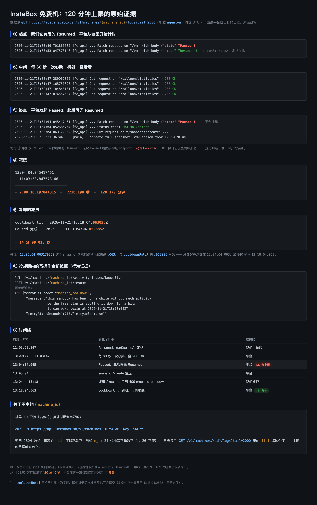

# 📊 InstaBox 免费机：120 分钟上限的原始证据

> **数据源** `GET https://api.instabox.sh/v1/machines/{machine_id}/logs?tail=2000`
> **机器** `agent-a` · **时区** UTC · 下面是平台自己打的日志，未经改写

本文所有时间戳都是 InstaBox 平台写在机器 console 里的原始行，不是本项目推断或计算的。
你可以用文末的命令在自己的机器上复现同样的输出。

---

## ① 起点：我们轮转后的 Resumed，平台从这里开始计时

```text
2026-11-21T11:03:49.701865682 [fc_api] ... Patch request on "/vm" with body {"state":"Paused"}
2026-11-21T11:03:53.847573146 [fc_api] ... Patch request on "/vm" with body {"state":"Resumed"}   ← runStartedAt 定格在此
```

这两行成对出现，间隔 **4.15 秒**，是**我们自己**的轮转（上一轮 `dueByLimit` 触发）。
平台把 `runStartedAt` 记成 Resumed 那一刻：`11:03:53.847573146`。

---

## ② 中间：每 60 秒一次心跳，机器一直活着

```text
2026-11-21T13:00:47.289062052 [fc_api] Get request on "/balloon/statistics" → 200 OK
2026-11-21T13:01:47.165750820 [fc_api] Get request on "/balloon/statistics" → 200 OK
2026-11-21T13:02:47.184848131 [fc_api] Get request on "/balloon/statistics" → 200 OK
2026-11-21T13:03:47.074557637 [fc_api] Get request on "/balloon/statistics" → 200 OK
```

每分钟一次，全部 `200 OK`，一直持续到 `13:03:47`。
**没有空闲、没有中途挂起。**

---

## ③ 终点：平台发起 Paused，此后再无 Resumed

```text
2026-11-21T13:04:04.045417461 [fc_api] ... Patch request on "/vm" with body {"state":"Paused"}   ← 平台挂起
2026-11-21T13:04:04.052685764 [fc_api] ... Status code: 204 No Content
2026-11-21T13:05:04.063170362 [fc_api] ... Put request on "/snapshot/create" ...
2026-11-21T13:05:23.367048358 [main]   'create full snapshot' VMM action took 19302670 us
```

> [!IMPORTANT]
> 对比 ① 中那次 `Paused` —— 4 秒后就有 `Resumed`；这次 `Paused` 后面接的是 `snapshot`，**没有 `Resumed`**。
> 同一份日志流里两种形态 —— 这是判断「谁干的」的判据。

---

## ④ 减法

```text
13:04:04.045417461
− 11:03:53.847573146
────────────────────────
= 2:00:10.197844315   =   7210.198 秒   =   120.170 分钟
```

**120 分 10.198 秒**。不是 119 分，也不是 121 分。误差 10 秒来自平台自己的调度粒度。

---

## ⑤ 冷却的减法

```text
cooldownUntil    2026-11-21T13:18:04.063026Z
Paused 完成      2026-11-21T13:04:04.052685Z
────────────────────────
= 14 分 00.010 秒
```

旁证：`13:05:04.063170362` 这个 `snapshot/create` 请求的毫秒尾数也是 `.063`，与 `cooldownUntil` 的 `.063026` 同源 —— 冷却起算点锚在 `13:04:04.063`，加 840 秒 = `13:18:04.063`。

所以 **冷却就是 14 分钟整**。

---

## ⑥ 冷却期内的写操作全部被拒（行为证据）

```bash
PUT  /v1/machines/{machine_id}/activity-leases/keepalive
POST /v1/machines/{machine_id}/resume
# 两者都返回：
```

```json
409 {"error":{
      "code": "machine_cooldown",
      "message": "this sandbox has been on a while without much activity,
                  so the free plan is cooling it down for a bit;
                  it can wake again at 2026-11-21T13:18:04Z",
      "retryAfterSeconds": 715,
      "retryable": true
    }}
```

`retryAfterSeconds` 实测从 `715` 递减到 `689`，与 `cooldownUntil` 吻合。
平台把 120 分钟上限包装成「免费计划冷却」这个错误码。

---

## ⑦ 时间线

| 时刻 (UTC) | 发生了什么 | 谁做的 |
| --- | --- | --- |
| `11:03:53.847` | `Resumed`，`runStartedAt` 定格 | 我们（轮转） |
| `13:00:47` → `13:03:47` | 每 60 秒一次心跳，全 `200 OK` | 平台 |
| **`13:04:04.045`** | **`Paused`，此后再无 `Resumed`** | **平台** 🔴 120 分上限 |
| `13:05:04` | `snapshot/create` 落盘 | 平台 |
| `13:04` → `13:18` | 续租 / resume 全部 `409 machine_cooldown` | 我们被拒 |
| `13:18:04.063` | `cooldownUntil` 到期，可再唤醒 | 平台 🟢 +14 分钟 |

---

## 关于图中的 `{machine_id}`

机器 ID 已换成占位符。复现时用你自己的：

```bash
curl -s https://api.instabox.sh/v1/machines -H "X-API-Key: $KEY"
```

返回 JSON 数组，每项的 `id` 字段就是它，形如 `m_` + 24 位小写字母数字（共 26 字符）。
日志接口 `GET /v1/machines/{id}/logs?tail=2000` 里的 `{id}` 填这个值 —— 本文的数据就来自它。

> [!NOTE]
> `machine_id` 是单台机器的标识，不是凭据。真正能操作你所有机器的是 `INSTABOX_API_KEY`（`ibk_` 开头，56 字符）—— 那个务必只放 Cloudflare Secret 里，不要提交到仓库。

### 完整复现步骤

```bash
# 1. 列出你的机器，拿到 id
curl -s https://api.instabox.sh/v1/machines -H "X-API-Key: $KEY" | jq -r '.[] | "\(.id)  \(.name)"'

# 2. 拉这台机器的日志，只看状态切换
curl -s "https://api.instabox.sh/v1/machines/{id}/logs?tail=2000" \
     -H "X-API-Key: $KEY" \
  | jq -r .console \
  | grep 'Patch request on "/vm"'

# 3. 用 awk 算相邻 Paused → Resumed 的间隔（秒）
#    正常轮转：2–4 秒；平台强挂：>3600 秒或没有 Resumed
```

---

## 结论

**唯一变量是运行时长**：

- 机器没空闲（心跳连续）
- 没被我们动（`Paused` 后无 `Resumed`）
- 续租一直在发（`409` 说明发了但被拒）

剩下的唯一解释就是它从 `11:03:53` 起连续跑了 **120 分 10 秒**，平台在这一刻强制挂起并冷却 **14 分钟**。

> [!TIP]
> 本项目默认配置根本不会走到这一步：`120 − 20（提前量）= 100 分钟` 就会由 `dueByLimit` 主动轮转一次，计时清零。
> **120 分钟是设计里的最后一道防线，不是常态。**

---

## 附图



---

## 补充说明

`cooldownUntil` 是机器对象上的字段，即使机器后来被唤醒也不会清空 —— 本文中它从 21:18 之后一直显示 `2026-11-21T13:18:04.063Z`，是历史值，不代表当前仍在冷却。
判断是否仍在冷却要看 `state`（`suspended` + `cooldownUntil > now` 才是真冷却）。
